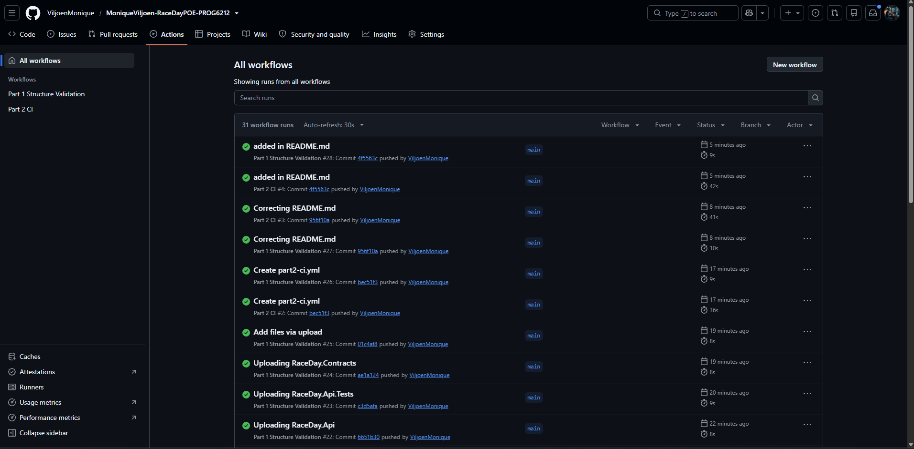

# RaceDay – Full-Stack Event Management System

**Module:** PROG6212 – Programming 2B  
**Student Name:** Monique Viljoen  
**Student Number:** ST10465636

## Project Description

RaceDay is a full-stack event management system designed for the South African road running, walking, and cycling community.  
The system allows Event Organisers to create and manage events, categories, and results, while Participants can browse events, enrol, and track their personal performance.

This repository contains all three parts of the Portfolio of Evidence.

---

## User Roles

### Organiser
- Register and log in
- Create, update, and delete events
- Manage categories for events
- View enrolments for their events
- Capture race results (finish times and positions)

### Participant
- Register and log in
- Browse available events and categories
- Enrol in events
- View personal enrolments and results
- Update their own profile

---

## Part 1 – System Planning and Database

- Entity Relationship Diagram (ERD)
- API Endpoint Plan
- SQL Database Script

All planning documents are available in the `/docs` folder.

**Part 1 Video:** https://youtu.be/qv_kAdhozjU

---

## Part 2 – RESTful API Development

### Technologies Used
- ASP.NET Core Web API (.NET 8)
- Entity Framework Core (Code-First)
- SQL Server
- Session-based Authentication
- BCrypt Password Hashing
- Swagger / OpenAPI
- xUnit Unit Tests
- GitHub Actions CI/CD

### How to Run the API

1. Open the solution (`RaceDay.Api.sln`) in Visual Studio 2022.
2. Update the connection string in `appsettings.json` if needed.
3. Run the following commands in the Package Manager Console:
4. Press `F5` to run the API.
5. Swagger will open at: `https://localhost:xxxx/swagger`

### Running the Unit Tests

1. Open **Test Explorer** in Visual Studio.
2. Click **Run All**.
3. All tests should pass.

### API Endpoints Overview
- Authentication (`/api/auth`)
- Profile (`/api/profile`)
- Events (`/api/events`)
- Categories (`/api/categories`)
- Enrolments (`/api/enrolments`)
- Results (`/api/results`)

### CI/CD
A GitHub Actions workflow is configured to restore, build, and run all unit tests on every push.

**CI Build Screenshot:**  


**Part 2 Video:** https://youtu.be/jQnxK9J5PcQ

---
## Repository Structure
```bash
RaceDay/                              ← Root of the repository
│
├── docs/                             ← Part 1 planning documents
│   ├── RaceDay_ERD.pdf
│   ├── RaceDay_API_Endpoint_Plan.pdf (or .md)
│   └── RaceDay_Database.sql
│
├── RaceDay.Api/                      ← ASP.NET Core Web API project
│   ├── Controllers/
│   │   ├── AuthController.cs
│   │   ├── ProfileController.cs
│   │   ├── EventsController.cs
│   │   ├── CategoriesController.cs
│   │   ├── EnrolmentsController.cs
│   │   └── ResultsController.cs
│   ├── Data/
│   │   └── RaceDayDbContext.cs
│   ├── Models/
│   │   ├── AppUser.cs
│   │   ├── Event.cs
│   │   ├── Category.cs
│   │   ├── Enrolment.cs
│   │   └── Result.cs
│   ├── Migrations/
│   ├── appsettings.json
│   ├── Program.cs
│   └── RaceDay.Api.csproj
│
├── RaceDay.Contracts/                ← Shared DTOs
│   ├── Dtos.cs
│   └── RaceDay.Contracts.csproj
│
├── RaceDay.Api.Tests/                ← Unit Tests
│   ├── AuthAndRoleTests.cs
│   └── RaceDay.Api.Tests.csproj
│
├── .github/
│   └── workflows/
│       ├── part1-ci.yml              ← (optional - keep from Part 1)
│       └── part2-ci.yml              ← Part 2 CI workflow
│
├── RaceDay.sln                       ← Solution file
└── README.md                         ← Updated README

